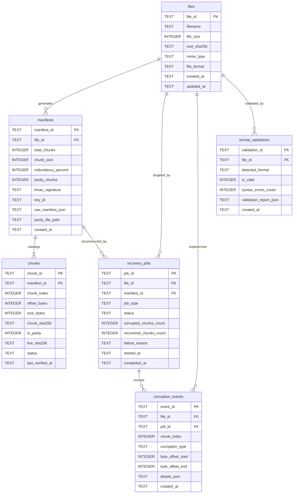

# ReSecure Database Architecture & Seed Pipeline

**Package Path**: `resecure/database/` (and root `database/`)  
**Database Engine**: SQLite 3.35+ (Local-Only Embedded Relational DB)  
**Concurrency Configuration**: PRAGMA journal_mode = WAL (Write-Ahead Logging)  
**Schema Artifact**: `resecure_schema.sql` (mirrors `contracts/resecure/schema.sql`)  
**Seeding Harness**: `seeds.py`  

---

## 1. Architectural Mission

ReSecure's data tier provides low-latency, ACID-compliant persistence for file integrity audits, cryptographic manifests, chunk catalogs, and forensic telemetry reports without introducing heavy external database dependencies (like PostgreSQL or MySQL).

### Relational Storage Tenets:
1. **Local-First Air-Gap**: The entire database lives in a local file (`resecure.db`). No cloud credentials, no network ports, and no outbound data transmission.
2. **High-Concurrency WAL Mode**: By configuring `PRAGMA journal_mode = WAL` and `PRAGMA synchronous = NORMAL`, readers never block writers, and writers never block readers during parallel file audits.
3. **Strict Referential Integrity**: Foreign keys are enforced via `PRAGMA foreign_keys = ON`. Deleting a file cascades deletions to its manifests and chunk records (`ON DELETE CASCADE`).
4. **Audit Immutability**: Timestamps (`created_at`, `updated_at`, `last_verified_at`) are automatically generated in ISO-8601 UTC format (`strftime('%Y-%m-%dT%H:%M:%fZ', 'now')`) via database triggers.

---

## 2. Relational Schema Entity Breakdown



---

## 3. Seed Fixtures & Deterministic Initialization

The script `resecure/database/seeds.py` provides deterministic data fixtures for testing, development, and class demonstrations.

### Seeded Fixtures:
- **Pristine Financial Ledger (`audit_ledger_2026.csv`)**: 192KB CSV file, 3 chunks (all `HEALTHY`), 100% health score, verified HMAC manifest.
- **Corrupted Authentication Microservice Config (`appsettings.json`)**: 64KB JSON file with a corrupted chunk (status `CORRUPTED`, damage type `BIT_FLIP`).
- **Damaged Executive Avatar (`ciso_badge.png`)**: 256KB PNG image with truncated chunks (status `MISSING`).
- **Ransomware-Wiped Audit Record (`q3_forensic_dump.bin`)**: High-entropy encrypted binary block.

### Running Seeds Manually:
```powershell
.\resecure\backend\venv\Scripts\python.exe resecure/database/seeds.py
```
Output:
```
Database seeded successfully:
  files: 4 records seeded
  manifests: 2 records seeded
  chunks: 15 records seeded
  jobs: 3 records seeded
  corruption_events: 1 records seeded
  format_validations: 3 records seeded
```
