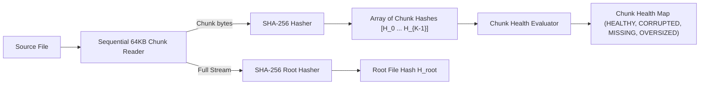
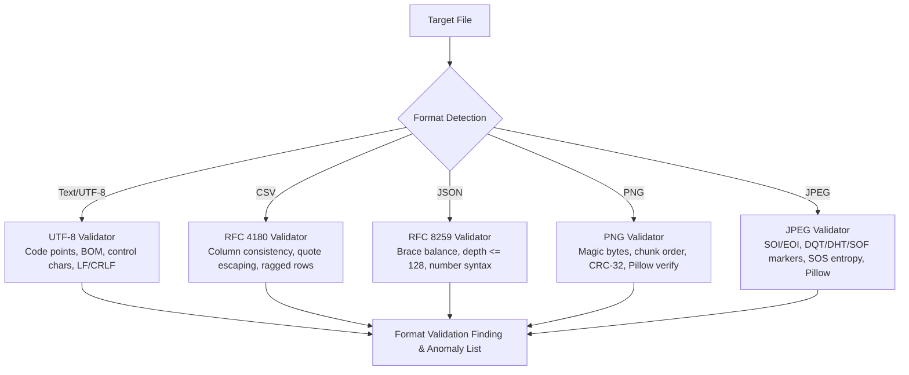
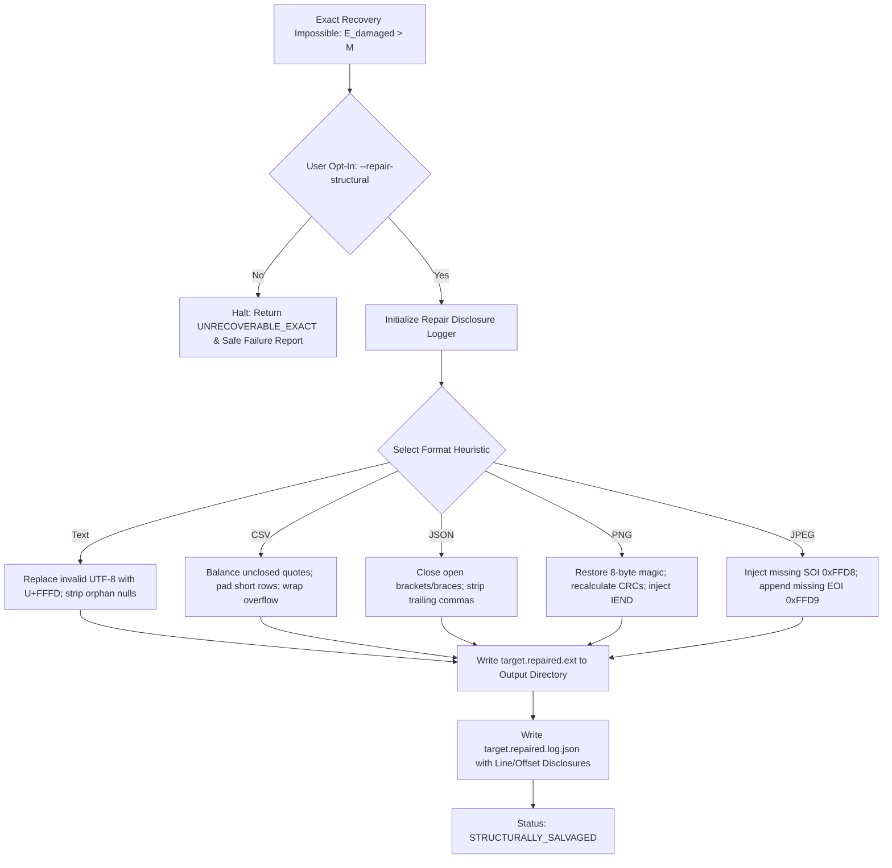
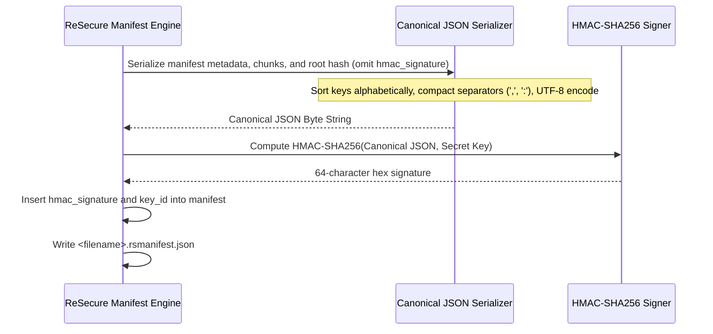
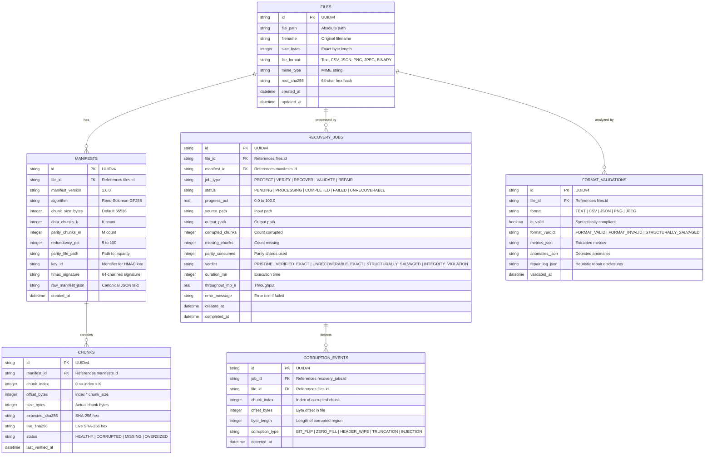
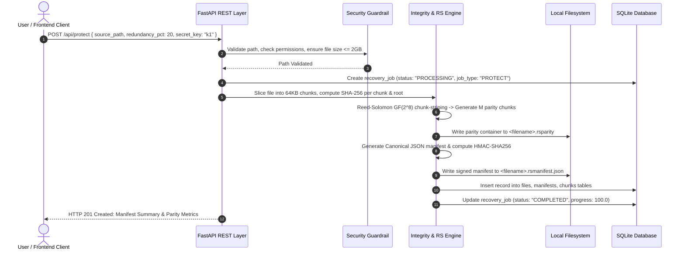
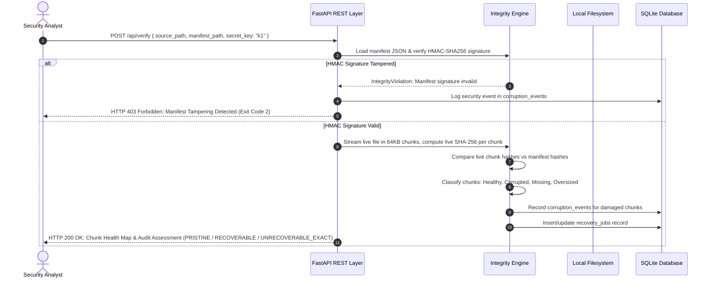
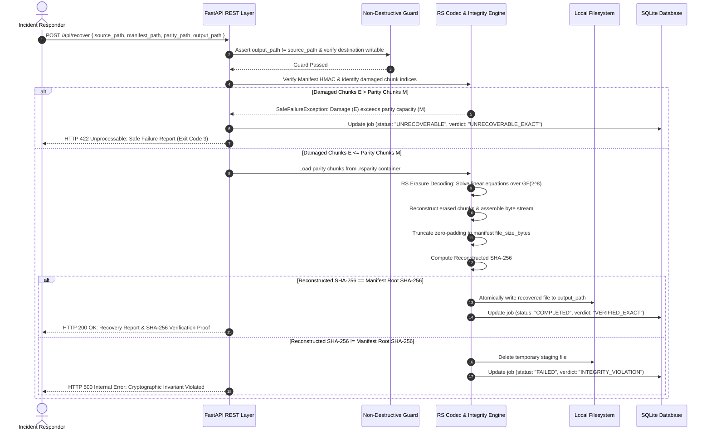
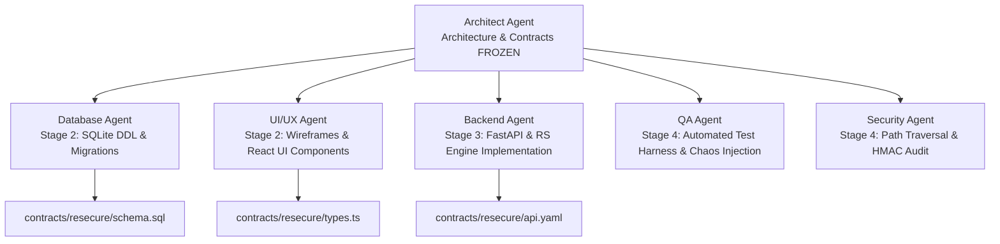

# System Architecture Specification
# ReSecure: Cryptographic File Integrity Verification, Corruption Detection & Resilient Recovery (MVP v1.0)

**Document Reference**: `docs/architecture/resecure-architecture.md`  
**Secondary Location**: `resecure/docs/architecture/resecure-architecture.md`  
**Status**: APPROVED / ARCHITECTURE FROZEN  
**Author**: Architect Agent (`TASK-RS-002`)  
**Product Reference**: `docs/prd/resecure-mvp.prd.md`  
**Security Classification**: High-Integrity Local Cybersecurity Utility  
**Version**: 1.0.0  

---

## 1. Executive Summary & Architectural Mission

**ReSecure** is a zero-trust, local-first cybersecurity application engineered to provide proactive data resilience, cryptographic file integrity verification, rapid tampering detection, and mathematical file recovery. Operating under strict non-destructive principles, ReSecure protects critical digital assets against silent bit rot, ransomware header tampering, network transmission truncation, and storage degradation.

Unlike probabilistic, generative AI approaches that hallucinate plausible content when data is damaged, ReSecure relies strictly on deterministic mathematics: **Galois Field $GF(2^8)$ Reed-Solomon Erasure Coding** coupled with chunk-level **SHA-256 cryptographic hashing** and **HMAC-SHA256 authenticated manifests**. 

The fundamental architectural promise of ReSecure is:
1. **Mathematical Invariance**: An exact recovery is only declared successful if and only if the reconstructed file's SHA-256 hash matches the pristine original SHA-256 recorded in the authenticated manifest bit-for-bit.
2. **Non-Destructive Guarantee**: Input source files are treated as immutable evidentiary artifacts. The system never overwrites, alters, or truncates source files in-place.
3. **Safe Failure Protocol**: When damage exceeds the parity threshold ($E_{\text{damaged}} > M$), ReSecure refuses to emit pseudo-recovered corrupted files. It fails safely and honestly, generating detailed forensic diagnostics and offering segregated heuristic repairs only upon explicit request.
4. **Air-Gapped Sovereignty**: 100% of cryptographic, erasure-coding, and format-validation workloads execute locally in user space without external network calls or cloud telemetry.

---

## 2. Core Architectural Principles & System Tenets

```
+---------------------------------------------------------------------------------------------------+
|                                RESECURE ARCHITECTURAL FOUNDATIONS                                 |
+---------------------------------------------------------------------------------------------------+
|  TENET 1: CRYPTOGRAPHIC DETERMINISM                                                                |
|  Zero generative hallucination. Reconstruction is pure linear algebra over GF(2^8). A recovered   |
|  file must match its original SHA-256 root hash bit-for-bit before write commit.                  |
|                                                                                                   |
|  TENET 2: NON-DESTRUCTIVE ISOLATION                                                               |
|  Input source files are opened read-only (O_RDONLY / FileShare.Read). Output files are written to   |
|  distinct user-designated paths. In-place overwrites are structurally blocked.                    |
|                                                                                                   |
|  TENET 3: FAIL-SAFE HONESTY                                                                       |
|  When corrupted chunks exceed parity shards, the system halts exact recovery, returns Exit Code 3 |
|  (ERR_EXCEEDS_REDUNDANCY), and purges temporary buffers. No corrupt data is passed as clean.     |
|                                                                                                   |
|  TENET 4: AUTHENTICATED MANIFESTS                                                                 |
|  Integrity manifests are tamper-evident via canonical JSON and HMAC-SHA256 signatures. Any         |
|  unauthorized modification of chunk hashes triggers an immediate fail-closed security alert.      |
|                                                                                                   |
|  TENET 5: BOUNDED RESOURCE STREAMING                                                              |
|  Large files (up to 2.0 GB) are processed via fixed 64KB chunk streaming buffers. Memory resident |
|  set size (RSS) remains bounded at <= 150 MB regardless of file size.                             |
+---------------------------------------------------------------------------------------------------+
```

---

## 3. System Topology & Tier Decomposition

The ReSecure platform is structured as a modular, local-first system comprising a React 18 Single-Page Application (SPA) frontend, a high-throughput Python 3.13 FastAPI backend service, an embedded SQLite relational database, and an isolated Core Cryptographic & Erasure Coding Engine.

```mermaid
flowchart TB
    subgraph ClientTier ["Client Presentation Layer (React 18 + Vite + Tailwind CSS)"]
        UI_DASH["Integrity Dashboard<br/>(Live Status, Quotas, Metrics)"]
        UI_PROT["Protection Studio<br/>(File Ingestion, Redundancy Slider, Key Config)"]
        UI_AUDIT["Audit & Inspection Panel<br/>(Chunk Health Grid, Byte Diff Inspector)"]
        UI_REC["Recovery Center<br/>(Parity Solver, Hash Verification, Safe Fallback)"]
        UI_VAL["Format Validator & Repairer<br/>(Deep Structural Analysis, Salavaged Logs)"]
    end

    subgraph APITier ["Application & API Gateway Tier (Python 3.13 + FastAPI)"]
        ROUTER["FastAPI REST Router (/api/*)"]
        SEC_GUARD["Security Middleware<br/>(Path Traversal Jail, CORS, Rate Limit)"]
        JOB_MGR["Async Job Manager & Task Queue<br/>(Background Worker ThreadPool)"]
    end

    subgraph CoreEngineTier ["ReSecure Core Engine (Modular Python Subsystems)"]
        INTEG_ENG["Integrity Engine<br/>(SHA-256 Root & 64KB Chunk Hasher)"]
        RS_CODEC["Reed-Solomon Codec Engine<br/>(GF(2^8) Chunk-Striped Erasure Coding)"]
        FORMAT_ENG["Format Validation Engine<br/>(Pillow & Stream Parsers: Text, CSV, JSON, PNG, JPEG)"]
        REPAIR_ENG["Structural Repair Engine<br/>(Best-Effort Heuristic Fallback & Disclosure Logger)"]
        MANIFEST_ENG["Manifest & Key Manager<br/>(Canonical JSON, HMAC-SHA256, Secret Separation)"]
        REPORT_ENG["Forensic Audit Report Engine<br/>(JSON Telemetry, Human Summaries)"]
    end

    subgraph StorageTier ["Persistence & Storage Layer (Local-Only)"]
        SQLITE_DB[("SQLite Metadata Database<br/>(WAL Mode, Foreign Keys, Audit Logs)")]
        LOCAL_FS[("Host Filesystem<br/>(Source Files, .rsmanifest.json, .rsparity, Outputs)")]
    end

    ClientTier -->|HTTP / REST (JSON + Multipart)| ROUTER
    ROUTER --> SEC_GUARD
    SEC_GUARD --> JOB_MGR
    JOB_MGR --> INTEG_ENG
    JOB_MGR --> RS_CODEC
    JOB_MGR --> FORMAT_ENG
    JOB_MGR --> REPAIR_ENG
    JOB_MGR --> MANIFEST_ENG
    JOB_MGR --> REPORT_ENG

    INTEG_ENG --> LOCAL_FS
    RS_CODEC --> LOCAL_FS
    FORMAT_ENG --> LOCAL_FS
    REPAIR_ENG --> LOCAL_FS
    MANIFEST_ENG --> LOCAL_FS

    JOB_MGR --> SQLITE_DB
    REPORT_ENG --> SQLITE_DB
    REPORT_ENG --> LOCAL_FS
```

---

## 4. Modular Subsystem Architecture

### 4.1 Subsystem 1: Integrity Engine

The Integrity Engine is responsible for cryptographic chunking, hashing, and live health evaluation.



#### Specifications:
1. **Fixed Chunk Slicing**:
   - Standard chunk size $S_c = 65,536\text{ bytes}$ (64 KB). Configurable to 16 KB, 256 KB, or 1 MB.
   - Total data chunks $K = \lceil \text{file\_size\_bytes} / S_c \rceil$.
   - The final chunk $K-1$ may contain $L < S_c$ bytes. In memory, it is zero-padded to $S_c$ for uniform Galois Field arithmetic, but the exact byte length $\text{file\_size\_bytes}$ is recorded in the manifest to ensure perfect truncation upon recovery.
2. **Cryptographic Hashing**:
   - Python `hashlib.sha256()` computes digest outputs formatted as 64-character lowercase hexadecimal strings.
   - Computes both individual chunk hashes $h_i = \text{SHA-256}(C_i)$ and full-file root hash $H_{\text{root}} = \text{SHA-256}(\text{File})$.
3. **Chunk Health Classification**:
   - `HEALTHY`: Live chunk exists at index $i$, offset $i \times S_c$, and its live SHA-256 matches manifest $h_i$.
   - `CORRUPTED`: Live chunk exists, but live SHA-256 does not match manifest $h_i$ (bit flip, overwritten bytes, ransomware header modification).
   - `MISSING`: Target file length is less than $(i + 1) \times S_c$ (file truncation, missing sectors).
   - `OVERSIZED`: Target file contains extraneous bytes beyond original $\text{file\_size\_bytes}$.
4. **Health Score Calculation**:
   $$\text{Health Percentage} = \left(\frac{\text{Count of Healthy Chunks}}{K}\right) \times 100.0$$

---

### 4.2 Subsystem 2: Reed-Solomon Codec Engine

The Reed-Solomon Codec Engine implements chunk-striped Forward Error Correction (FEC) over Galois Field $GF(2^8)$, generating $M$ parity chunks from $K$ original data chunks.

```
Original File: [ Chunk 0 ] [ Chunk 1 ] ... [ Chunk K-1 ]
                    |           |               |
                    v           v               v
Byte Index j:     Byte 0      Byte 0          Byte 0   --> [RS Encoder GF(2^8)] --> Parity Byte 0..M-1
                    |           |               |
                    v           v               v
Byte Index j+1:   Byte 1      Byte 1          Byte 1   --> [RS Encoder GF(2^8)] --> Parity Byte 0..M-1
                    :           :               :
Resulting Parity: [ Parity Chunk 0 ] [ Parity Chunk 1 ] ... [ Parity Chunk M-1 ]
```

#### Specifications:
1. **Galois Field $GF(2^8)$ Arithmetic**:
   - Operates on 8-bit symbols ($0 \le x \le 255$) using primitive polynomial $p(x) = x^8 + x^4 + x^3 + x^2 + 1$ ($0x11D$).
   - Utilizes `reedsolo.RSCodec` or Vandermonde/Cauchy generator matrices.
   - Redundancy ratio: $R \in [5, 100]\%$, default $20\%$.
   - Parity chunks: $M = \lceil K \times (R / 100) \rceil$.
2. **Chunk-Striped Processing (Byte-Interleaved)**:
   - To encode chunks of size $S_c = 64\text{ KB}$, the engine does not treat an entire 64KB chunk as a single symbol.
   - For every byte offset $j \in [0, S_c - 1]$, the vector of bytes across all $K$ chunks $\vec{d}_j = [C_0[j], C_1[j], \dots, C_{K-1}[j]]$ forms a message codeword.
   - The encoder computes $M$ parity bytes $\vec{p}_j = [P_0[j], P_1[j], \dots, P_{M-1}[j]]$.
   - Parity byte $P_m[j]$ is stored at byte offset $j$ of parity chunk $m$.
3. **Erasure Decoding Protocol**:
   - Because the Integrity Engine pre-identifies exact corrupted or missing chunk indices, every bad chunk is treated as a **known erasure** (rather than an unknown error).
   - In Reed-Solomon coding, knowing the erasure positions doubles decoding efficiency: an $(N, K)$ code can correct up to $M = N - K$ erasures (whereas it could only correct $\lfloor M/2 \rfloor$ unknown errors).
   - If total damaged chunks $E_{\text{damaged}} = \text{count}(\text{corrupted}) + \text{count}(\text{missing}) \le M$, the erasure decoding matrix is inverted and all $E_{\text{damaged}}$ chunks are mathematically reconstructed.
4. **Parity Binary Container Format (`.rsparity`)**:
   Parity shards are serialized into a standardized binary container:

```
+------------------+------------------+-----------------------------------------+
| Field            | Size             | Description                             |
+------------------+------------------+-----------------------------------------+
| Magic Header     | 8 Bytes          | ASCII "RSPARITY" (0x52 53 50 41 52 49 54 59) |
| Format Version   | 2 Bytes (uint16) | Version (0x0001, Little Endian)         |
| Chunk Size (S_c) | 4 Bytes (uint32) | Chunk size in bytes (e.g. 65536)        |
| Data Chunks (K)  | 2 Bytes (uint16) | Number of original data chunks          |
| Parity Chunks(M) | 2 Bytes (uint16) | Number of parity chunks                 |
| Reserved / Flags | 16 Bytes         | Reserved for cryptographic checksums    |
+------------------+------------------+-----------------------------------------+
| Parity Chunk 0   | S_c Bytes        | Raw bytes for parity block 0            |
| Parity Chunk 1   | S_c Bytes        | Raw bytes for parity block 1            |
| ...              | ...              | ...                                     |
| Parity Chunk M-1 | S_c Bytes        | Raw bytes for parity block M-1          |
+------------------+------------------+-----------------------------------------+
```

---

### 4.3 Subsystem 3: Format Validation Engine

The Format Validation Engine performs deep syntactic, structural, and semantic inspection for five high-value file formats without executing untrusted code.



#### Detailed Validation Rules:
1. **Plain Text / UTF-8 (`.txt`, `.log`, `.md`, `.sql`, `.yaml`)**:
   - Stream validation of multi-byte UTF-8 sequences. Detects overlong encodings, illegal lead bytes (`0xC0`, `0xC1`, `0xF5`-`0xFF`), and truncated sequences.
   - Byte Order Mark (BOM) detection (`EF BB BF`).
   - Detection of forbidden binary control characters (bytes $0x00 \dots 0x08, 0x0B, 0x0C, 0x0E \dots 0x1F$). Standard whitespace ($0x09$ TAB, $0x0A$ LF, $0x0D$ CR) is permitted.
   - Consistency check of newline conventions (pure LF vs. CRLF vs. mixed).
2. **Comma-Separated Values (`.csv`)**:
   - RFC 4180 parser adherence.
   - Strict column count consistency: Header row defines column count $C_{\text{expected}}$. Every subsequent row must equal $C_{\text{expected}}$.
   - Quote balance: Quotation marks (`"`) must occur in matching pairs. Quoted fields containing quotes, delimiters, or newlines must follow RFC 4180 escaping rules.
   - Ragged row identification: Pinpoints exact row number and column deficit or surplus.
3. **JavaScript Object Notation (`.json`)**:
   - RFC 8259 compliance via incremental streaming or strict `json.loads` parser.
   - Structural delimiter balance: Stack-based verification of matching `{}` and `[]`.
   - Maximum recursion depth limit: Capped at 128 levels to prevent stack exhaustion DoS.
   - Numeric compliance: Rejects unquoted `NaN`, `Infinity`, and numbers with leading zeros.
4. **Portable Network Graphics (`.png`)**:
   - Magic byte verification: First 8 bytes must strictly equal `89 50 4E 47 0D 0A 1A 0A`.
   - Chunk structure: Reads 4-byte Length, 4-byte Chunk Type, Length-byte Chunk Data, and 4-byte CRC-32.
   - Mandatory chunk sequence: `IHDR` must be the first chunk; `IEND` must be the last chunk.
   - CRC-32 validation: Computes IEEE 802.3 CRC-32 over (Chunk Type + Chunk Data) and compares against the recorded 4-byte CRC footer.
   - Pillow verification: `Image.open().verify()` parses compression stream and image dimension sanity.
5. **Joint Photographic Experts Group (`.jpeg`, `.jpg`)**:
   - Start of Image (SOI) marker (`0xFF 0xD8`) at byte offset 0.
   - End of Image (EOI) marker (`0xFF 0xD9`) at terminal bytes.
   - Structural marker segment parsing: Scans for `APP0`/`APP1` (`0xFF 0xE0`/`0xE1`), Define Quantization Table (`DQT`, `0xFF 0xDB`), Define Huffman Table (`DHT`, `0xFF 0xC4`), Start of Frame (`SOF0`, `0xFF 0xC0`), and Start of Scan (`SOS`, `0xFF 0xDA`).
   - Pillow verification: Validates decompression tables and entropy scan streams.

---

### 4.4 Subsystem 4: Structural Repair Engine (Best-Effort Heuristic Fallback)

When exact mathematical recovery is impossible ($E_{\text{damaged}} > M$ or missing parity file), the Structural Repair Engine provides an explicit, opt-in fallback to salvage readable content.



#### Structural Repair Invariants:
1. **Explicit Separation**:
   - Source file is never overwritten.
   - Output file is named `<filename>.repaired.<ext>` in the target output directory.
   - Accompanied by `<filename>.repaired.log.json` detailing every byte mutation.
2. **Classification Invariant**:
   - Output is classified strictly as `STRUCTURALLY_SALVAGED` (never `VERIFIED_EXACT`).
   - API and CLI emit prominent warnings that content was mutated to achieve structural compliance.

---

### 4.5 Subsystem 5: Manifest & Key Management

The Manifest & Key Management engine creates and authenticates tamper-evident manifests using HMAC-SHA256.



#### Canonicalization & Authentication Specifications:
1. **Canonical JSON Serialization**:
   - Manifest dictionary keys are sorted lexicographically (`sort_keys=True`).
   - Whitespace is eliminated between delimiters (`separators=(',', ':')`).
   - Enforce UTF-8 encoding.
2. **Signature Calculation**:
   - `hmac_payload = canonical_json(manifest_excluding_hmac_signature)`
   - `signature = hmac.new(secret_key.encode('utf-8'), hmac_payload.encode('utf-8'), hashlib.sha256).hexdigest()`
3. **Verification Invariant**:
   - Verification strips `hmac_signature` from the loaded manifest, serializes the remainder canonically, computes expected HMAC, and performs constant-time comparison `hmac.compare_digest(computed, recorded)`.
   - If signature mismatches or key is wrong, execution aborts immediately with Exit Code 2 (`ERR_MANIFEST_TAMPERED`).

---

### 4.6 Subsystem 6: Persistence & Storage Engine

ReSecure persists operational metadata, audit logs, and file histories using an embedded SQLite database (`resecure.db`).

#### Configuration:
- SQLite 3.35+ with Write-Ahead Logging (`PRAGMA journal_mode = WAL;`).
- Foreign keys enforced (`PRAGMA foreign_keys = ON;`).
- Synchronous mode normal (`PRAGMA synchronous = NORMAL;`).

#### Entity-Relationship Diagram:


---

### 4.7 Subsystem 7: REST API Layer

The REST API is implemented in Python 3.13 using FastAPI and Pydantic v2.

#### API Endpoints Summary:
- `POST /api/protect`: Upload or select file path, configure redundancy ($5\%-100\%$), generate manifest & parity, return manifest summary.
- `POST /api/verify`: Verify file integrity against manifest, detect altered/missing/corrupted chunks, return chunk health map.
- `POST /api/recover`: Reconstruct damaged file from parity, verify recovered SHA-256 == original SHA-256, write output, return recovery report.
- `POST /api/validate-format`: Validate format syntax and semantics (Text, CSV, JSON, PNG, JPEG).
- `POST /api/repair-format`: Best-effort heuristic structural repair fallback with full disclosure logging.
- `GET /api/jobs/{job_id}`: Poll asynchronous job progress and state.
- `GET /api/reports/{job_id}`: Retrieve detailed machine-readable forensic audit report.
- `GET /api/health`: Service liveness, SQLite connectivity, and engine readiness check.

---

### 4.8 Subsystem 8: Security & Guardrails

1. **Path Traversal Jail Protection**:
   - All input, output, manifest, and parity paths are canonicalized via `os.path.realpath()` and `pathlib.Path.resolve()`.
   - The system checks that resolved paths remain within designated working directories or explicit user allowlists.
   - Any attempt to reference directory escape patterns (`../`, `..\`, null bytes `\0`, or dangerous symlink redirection) triggers an immediate HTTP 400 / Exit Code 2 error.
2. **Non-Destructive Invariant**:
   - `source_path == output_path` is strictly prohibited. If resolved paths match, the operation is blocked before any file descriptor is created.
   - Source files are opened strictly in read-only mode (`rb` / `O_RDONLY`).
   - Recovered output files are written to temporary staging files (`.<filename>.tmp.<uuid>`) in the target directory, flushed to disk, and atomically renamed (`os.replace`) only after root SHA-256 validation passes.
3. **Bounded Memory Streaming**:
   - Files are read in sequential 64KB blocks.
   - Peak RSS is capped at $\le 150\text{ MB}$ even when processing maximum 2.0 GB files.
4. **Air-Gapped Guarantee**:
   - Zero outbound sockets or HTTP client libraries (`requests`, `httpx`, `urllib` calls outward) are initialized in the application core.

---

## 5. End-to-End Operational Workflows

### 5.1 Workflow A: File Protection & Parity Generation



---

### 5.2 Workflow B: Audit & Verification



---

### 5.3 Workflow C: Exact Bit-for-Bit File Recovery



---

## 6. Algorithmic Specifications

### 6.1 Galois Field $GF(2^8)$ Reed-Solomon Erasure Coding

Reed-Solomon erasure coding represents $K$ original data chunks as polynomial evaluation points or matrix multiplication inputs over Galois Field $GF(2^8)$.

#### Encoding:
Given $K$ data bytes $d_0, d_1, \dots, d_{K-1}$ at a specific chunk offset $j$:
1. A generator matrix $G$ of dimensions $(K + M) \times K$ is constructed over $GF(2^8)$. The upper $K \times K$ submatrix is the Identity matrix $I_K$, and the lower $M \times K$ submatrix is a Cauchy or Vandermonde matrix.
2. The codeword vector $\vec{c} = G \cdot \vec{d}$ yields $K$ systematic data symbols and $M$ parity symbols:
   $$p_m = \sum_{k=0}^{K-1} g_{m+K, k} \otimes d_k \quad (\text{in } GF(2^8))$$
3. Repeating this operation across all $S_c$ byte offsets yields $M$ full parity chunks.

#### Decoding (Erasure Recovery):
When $E \le M$ chunks are damaged:
1. Delete the rows corresponding to lost data chunks from matrix $G$, yielding a reduced matrix $G'$.
2. Select any $K$ available surviving rows from $G'$ (combining undamaged data chunks and required parity chunks) to form an invertible $K \times K$ matrix $A$.
3. Compute the inverse matrix $A^{-1}$ over $GF(2^8)$.
4. Multiply $A^{-1}$ by the vector of $K$ received symbols $\vec{r}$ to recover the original data vector $\vec{d}$:
   $$\vec{d} = A^{-1} \cdot \vec{r}$$
5. The recovered chunks replace the corrupted/missing blocks in the assembled output stream.

---

### 6.2 Best-Effort Heuristic Structural Repair Algorithms

When exact parity recovery is unavailable, the system applies the following safe transformations:

| Format | Defect Detected | Heuristic Mutation | Disclosure Log Record |
| :--- | :--- | :--- | :--- |
| **Text/UTF-8** | Truncated multi-byte sequence or invalid lead byte | Replace with Unicode Replacement Character `\uFFFD` | `{"action": "replace_bytes", "offset": X, "count": N, "replacement": "U+FFFD"}` |
| **Text/UTF-8** | Orphan binary nulls / non-printable control chars | Strip byte or replace with space | `{"action": "strip_control_char", "offset": X, "byte": "0x00"}` |
| **CSV** | Ragged row (missing columns) | Pad with trailing empty fields `,` to match header count | `{"action": "pad_columns", "row": 42, "columns_added": 2}` |
| **CSV** | Unclosed double quote before newline | Append closing quote `"` before line break | `{"action": "balance_quote", "row": 15, "line_offset": 820}` |
| **JSON** | Unterminated string literal before newline | Append `"` to terminate string token | `{"action": "close_string_literal", "line": 88}` |
| **JSON** | Truncated payload with open objects/arrays | Parse delimiter stack and append matching `}` and `]` | `{"action": "close_bracket_stack", "tokens_appended": "]}}"}` |
| **JSON** | Trailing commas before closing token (`[1, 2, ]`) | Remove illegal trailing comma | `{"action": "strip_trailing_comma", "offset": 1042}` |
| **PNG** | Corrupted 8-byte magic header | Re-inject `89 50 4E 47 0D 0A 1A 0A` if `IHDR` is intact | `{"action": "restore_png_magic", "offset": 0}` |
| **PNG** | Corrupted chunk CRC-32 | Recalculate IEEE 802.3 CRC-32 over chunk and update footer | `{"action": "recalculate_crc32", "chunk": "IHDR", "old_crc": "...", "new_crc": "..."}` |
| **PNG** | Missing terminal `IEND` chunk | Append standard 12-byte `IEND` chunk (`00 00 00 00 49 45 4E 44 AE 42 60 82`) | `{"action": "append_iend_chunk", "bytes_appended": 12}` |
| **JPEG** | Missing Start of Image (`SOI`) | Inject `0xFF 0xD8` at byte offset 0 | `{"action": "inject_soi_marker", "offset": 0}` |
| **JPEG** | Truncated file missing End of Image (`EOI`) | Append `0xFF 0xD9` to enable rendering of intact scans | `{"action": "append_eoi_marker", "offset": EOF}` |

---

## 7. Downstream Implementation Decoupling & Agent Responsibilities

To achieve rapid, error-free parallelism across the CalmStacks Agent Factory, this specification establishes strict contracts:



1. **Database Agent (Stage 2)**:
   - Deploy `contracts/resecure/schema.sql` to SQLite.
   - Implement repository query interfaces for `files`, `manifests`, `chunks`, `recovery_jobs`, `corruption_events`, and `format_validations`.
2. **UI/UX & Frontend Agent (Stage 2 / Stage 3)**:
   - Implement React 18 components conforming to `contracts/resecure/types.ts`.
   - Build Chunk Health visualizer grid, Redundancy slider, and Forensic Report viewer.
3. **Backend Agent (Stage 3)**:
   - Implement FastAPI endpoints matching `contracts/resecure/api.yaml`.
   - Implement `rs_codec.py`, `integrity_engine.py`, `format_validator.py`, and `repair_engine.py`.
4. **QA & Security Agents (Stage 4)**:
   - Construct synthetic test suites injecting bit flips, header overwrites, and path traversal attacks to verify mathematical and operational compliance.
