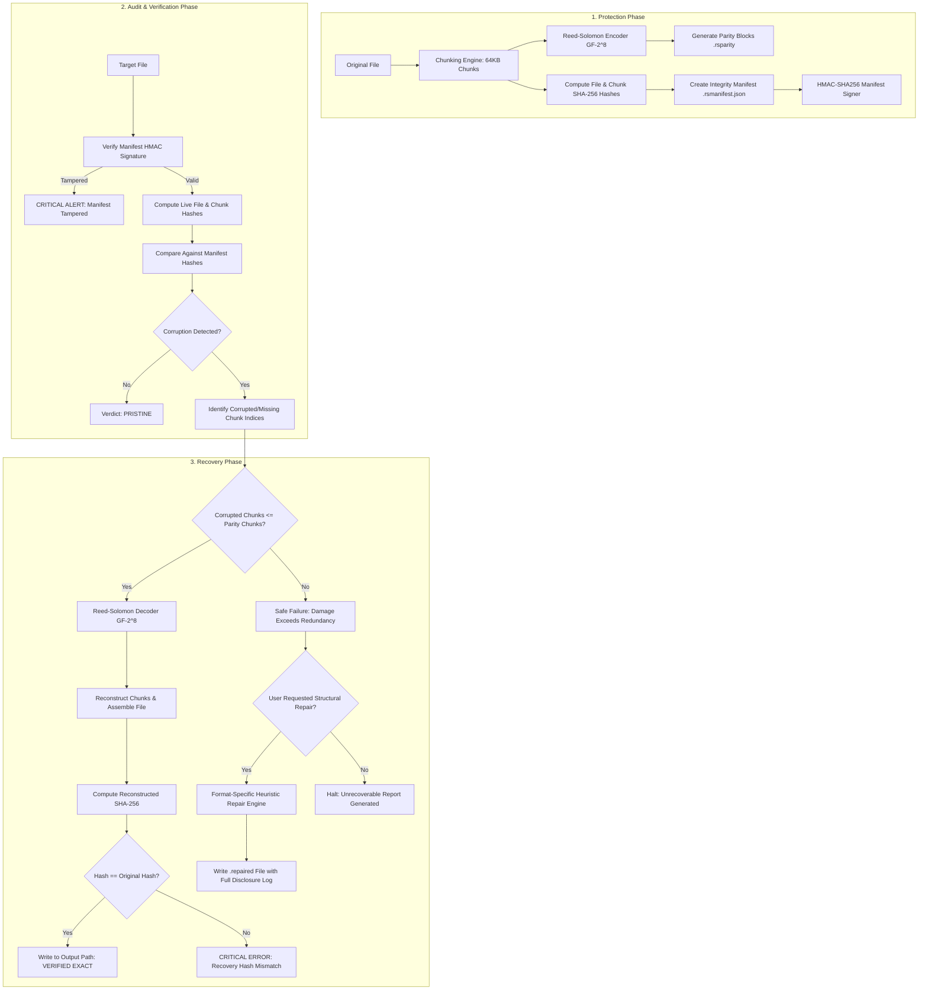
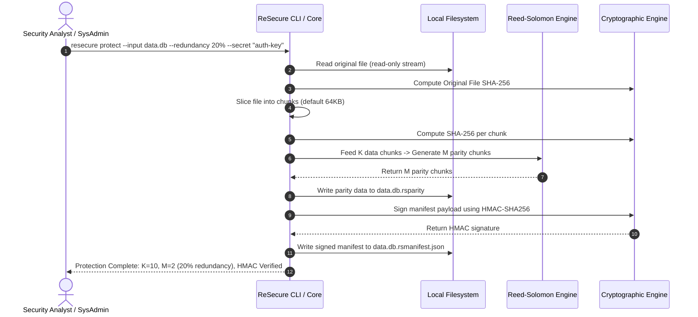
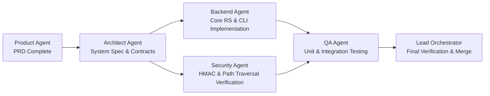

# Product Requirements Document (PRD)
# ReSecure: Cryptographic File Integrity Verification, Tamper Detection & Resilient Recovery (MVP v1.0)

**Document Reference**: `docs/prd/resecure-mvp.prd.md`  
**Secondary Location**: `resecure/docs/prd/resecure-mvp.prd.md`  
**Status**: APPROVED / SPECIFICATION COMPLETE  
**Author**: Product Agent (`skills/project-planning`)  
**Target Release**: ReSecure MVP v1.0  
**Security Classification**: High-Integrity Cybersecurity Utility  

---

## 1. Executive Summary & Problem Definition

### 1.1 Executive Summary
**ReSecure** is a zero-trust, local-first cybersecurity application engineered to provide proactive data resilience, cryptographic file integrity verification, rapid tampering detection, and mathematical file recovery. Operating under strict non-destructive principles, ReSecure protects mission-critical assets against silent data degradation, ransomware modification, network transit corruption, and localized storage faults.

ReSecure combines chunk-level cryptographic hashing (SHA-256) with Galois Field Reed-Solomon Erasure Coding ($GF(2^8)$) and authenticated metadata manifests (HMAC-SHA256). When protected files suffer byte corruption, missing chunks, unauthorized modification, or bit rot, ReSecure detects the precise byte offsets of damage and reconstructs the damaged or missing data blocks with bit-for-bit mathematical certainty. If damage exceeds the configured redundancy threshold, ReSecure executes a safe failure protocol, honestly reporting the unrecoverable state while offering safe, segregated heuristic structural repairs for supported file formats (Text, CSV, JSON, PNG, and JPEG).

ReSecure enforces an absolute **Non-Destructive Guarantee**: input source files are treated as immutable evidentiary artifacts and are never modified or overwritten in-place. All verification, reconstruction, and structural repairs are written to isolated, user-specified output destinations.

```
+---------------------------------------------------------------------------------------------------+
|                                 RESECURE SYSTEM VALUE PROPOSITION                                 |
+---------------------------------------------------------------------------------------------------+
|  1. Proactive Resiliency: Generates Reed-Solomon parity blocks before incidents occur.            |
|  2. Tamper Evident: Validates file + chunk SHA-256 hashes against HMAC-authenticated manifests.   |
|  3. Mathematical Recovery: Reconstructs exact files bit-for-bit, verified against root SHA-256.   |
|  4. Fail-Safe Honesty: Never emits corrupt data disguised as recovered; fails safely.            |
|  5. Multi-Format Validation: Deep structural validation for Text, CSV, JSON, PNG, and JPEG.      |
|  6. Forensic Non-Destruction: Zero in-place overwrites; source files remain strictly untouched.   |
|  7. Sovereign & Air-Gapped: 100% local processing; zero external telemetry or network calls.      |
+---------------------------------------------------------------------------------------------------+
```

---

### 1.2 Problem Definition

Modern enterprise and edge environments face pervasive threats to digital file integrity that traditional backups and basic checksums fail to mitigate effectively:

1. **Silent Bit Rot & Physical Media Degradation**:
   - Long-term magnetic and flash storage (HDDs, SSDs, optical drives) suffer physical charge leakage, cosmic ray single-event upsets (SEUs), and media degradation.
   - Operating systems and traditional filesystems (ext4, NTFS, APFS) routinely return corrupted sectors without throwing I/O errors.
   - Standard integrity checks can detect that a checksum no longer matches, but cannot recover the original data without an entire secondary copy.

2. **Ransomware Tampering & Malicious Payload Modification**:
   - Sophisticated ransomware and wiper malware frequently perform "intermittent encryption" or header poisoning (encrypting or flipping the first 1KB-64KB of files to evade heuristic detection while rendering files unreadable).
   - Attackers may modify configuration files, executable binaries, or operational logs to disable logging or introduce backdoor payloads while leaving file sizes intact.
   - Security teams require granular chunk-level visibility to identify the exact sectors modified by malicious agents.

3. **Transmission & In-Transit Network Corruption**:
   - File transfers over unstable networks, wireless relays, or untrusted communication channels experience packet drops, middlebox truncation, and byte injection.
   - Files arrive incomplete or subtly modified, breaking downstream automation, CI/CD pipelines, and secure deployments.

4. **Accidental File Corruption & Interrupted I/O**:
   - Abrupt power loss, kernel panics, premature device unmounting, and application crashes during write cycles leave files partially written, truncated, or zero-padded.
   - Organizations routinely discover that vital database exports, evidentiary media, or audit logs have been structurally broken.

5. **Limitations of Existing Tools**:
   - *Hashes alone* (`md5sum`, `sha256sum`): Detect damage, but offer zero recovery capability.
   - *Full Mirror Backups*: Consume 100% to 200% storage overhead per backup copy; slow to synchronize over bandwidth-constrained links.
   - *PAR2 / QuickPar*: Legacy, single-threaded tools lacking format-aware structural validation, tamper-evident authenticated manifests, modern machine-readable JSON telemetry, or programmatic API integration.
   - *In-Place Repair Utilities*: Dangerously overwrite source files, destroying forensic chain of custody and risking total file annihilation if repair heuristics fail.

---

## 2. Target Personas & User Profiles

### 2.1 Persona 1: Security Analyst (Integrity & Threat Verification)
- **Role**: SOC Analyst, Threat Hunter, Security Operations Specialist.
- **Context**: Investigating security alerts, verifying whether critical system files or telemetry logs have been altered, analyzing ransomware blast radiuses.
- **Pain Points**:
  - Unclear whether a modified file is benign administrator configuration drift or malicious tampering.
  - Cannot tell which specific file chunks were modified without slow hex-diffing.
  - Vulnerability of checksum manifests to attacker alteration if manifests are unauthenticated.
- **Key Goals**:
  - Verify authenticity of manifests using HMAC-SHA256 to guarantee the manifest has not been tampered with.
  - Detect precise chunk modifications and pinpoint corrupted sectors.
  - Validate forensic logs and configuration files without risking evidence contamination.

### 2.2 Persona 2: Systems Administrator / DevOps Engineer (Resilience & Automation)
- **Role**: Infrastructure Engineer, Storage Administrator, DevOps Lead.
- **Context**: Managing on-premise servers, cold storage archives, edge devices, and CI/CD artifact registries.
- **Pain Points**:
  - Silent bit rot silently corrupting critical configuration files, base disk images, and database snapshots.
  - Full mirror backups require immense storage quotas and bandwidth.
  - Needing headless, scriptable CLI automation that exits with deterministic status codes.
- **Key Goals**:
  - Protect critical directory trees and archives with tunable redundancy (e.g., 10% to 30% storage overhead).
  - Schedule periodic automated integrity audits across archives.
  - Automatically reconstruct corrupted files without manual intervention.

### 2.3 Persona 3: Incident Responder & Digital Forensics Specialist (Chain of Custody Recovery)
- **Role**: DFIR Specialist, Forensic Investigator, Forensic Lab Technician.
- **Context**: Recovering compromised systems post-incident, extracting damaged evidentiary images and logs from seized hardware.
- **Pain Points**:
  - Tools that modify or overwrite evidence in-place violate chain of custody and make forensic findings inadmissible in court.
  - Corrupted log files (JSON, CSV, syslog) that break forensic ingestion pipelines.
  - Overly optimistic recovery tools that output garbage data without verifying cryptographic root hashes.
- **Key Goals**:
  - Enforce absolute non-destructive guarantees: source media is mounted read-only and never modified.
  - Recover files to designated forensic workspaces and verify recovered files match the pristine pre-incident SHA-256 hash.
  - Obtain complete, timestamped, machine-readable recovery reports documenting every repaired chunk.

### 2.4 Persona 4: Enterprise Data Custodian (Compliance & Long-Term Preservation)
- **Role**: Compliance Officer, Records Manager, Legal Tech Custodian.
- **Context**: Long-term preservation of contracts, financial CSVs, evidentiary JPEG/PNG documents, and regulatory audit archives.
- **Pain Points**:
  - Archives stored in S3/Glacier or magnetic tape for 5-10 years suffer gradual degradation.
  - Inability to know if an archived PDF/PNG/CSV is valid until a user tries to open it years later.
  - If a file is partially unrecoverable, complete abandonment of the file loses vital historical records.
- **Key Goals**:
  - Routine deep format validation across standard document types (Text, CSV, JSON, PNG, JPEG).
  - Safe structural repair fallback for partially corrupted business files when exact parity recovery is not available, with honest disclosure of truncated/salvaged rows.

---

## 3. Core Product Principles & Non-Negotiable Tenets

```
+---------------------------------------------------------------------------------------------------+
|                                 CORE PRODUCT TENETS FOR RESECURE                                  |
+---------------------------------------------------------------------------------------------------+
|  TENET 1: CRYPTOGRAPHIC INVARIANCE                                                                |
|  An exact recovery is only declared SUCCESSFUL if the computed SHA-256 hash of the reconstructed  |
|  file matches the original file SHA-256 hash recorded in the trusted manifest bit-for-bit.        |
|                                                                                                   |
|  TENET 2: NON-DESTRUCTIVE GUARANTEE                                                               |
|  The input source file is treated as an immutable evidentiary artifact. ReSecure NEVER modifies,  |
|  truncates, or overwrites input source files in-place. Recovered files are written to separate     |
|  output paths designated by the user.                                                             |
|                                                                                                   |
|  TENET 3: HONEST & SAFE FAILURE (ZERO HALLUCINATED RECOVERY)                                     |
|  If corruption exceeds the redundancy capacity of Reed-Solomon parity, ReSecure NEVER produces a  |
|  corrupted output file and claims it is recovered. It safely fails, reporting exact damage metrics|
|  and preventing corrupted data from entering production pipelines.                                |
|                                                                                                   |
|  TENET 4: AUTHENTICATED INTEGRITY MANIFESTS                                                       |
|  Integrity manifests are signed using HMAC-SHA256 with a pre-shared secret key. An unauthenticated|
|  or tampered manifest triggers an immediate hard-stop security alert to prevent attackers from    |
|  forging parity data.                                                                             |
|                                                                                                   |
|  TENET 5: LOCAL-FIRST, AIR-GAPPED SOVEREIGNTY                                                     |
|  All processing is 100% local. Zero network requests, zero telemetry, zero cloud dependencies.    |
+---------------------------------------------------------------------------------------------------+
```

---

## 4. System Architecture & Workflows

### 4.1 High-Level Architecture Overview



---

### 4.2 End-to-End Operation Workflows

#### Workflow A: File Protection & Parity Creation


#### Workflow B: Verification & Mathematical Recovery
```mermaid
sequenceDiagram
    autonumber
    actor User as Incident Responder
    participant CLI as ReSecure CLI / Core
    participant IO as Local Filesystem
    participant RS as Reed-Solomon Engine
    participant Crypto as Cryptographic Engine

    User->>CLI: resecure recover --input data.db --manifest data.db.rsmanifest.json --output ./restored/
    CLI->>IO: Verify source file exists; ensure output != source path
    CLI->>Crypto: Verify Manifest HMAC Signature
    alt Manifest Signature Invalid
        CLI-->>User: ABORT: Manifest signature verification failed (Tampering detected)
    else Manifest Signature Valid
        CLI->>IO: Read live target file
        CLI->>Crypto: Compute live chunk SHA-256 hashes
        CLI->>CLI: Compare live hashes vs manifest chunk hashes
        Note over CLI: Detects Chunk #2 and Chunk #5 corrupted (2 chunks damaged)
        CLI->>IO: Load parity chunks from data.db.rsparity
        CLI->>RS: Decode: K healthy chunks + 2 parity chunks -> Solve lost chunks
        RS-->>CLI: Recovered Chunk #2 and Chunk #5
        CLI->>CLI: Assemble reconstructed byte stream
        CLI->>Crypto: Compute reconstructed file SHA-256
        CLI->>CLI: Compare reconstructed SHA-256 vs manifest original SHA-256
        alt Hashes Match Perfectly
            CLI->>IO: Atomically write recovered file to ./restored/data.db
            CLI->>IO: Write detailed recovery report ./restored/recovery_report.json
            CLI-->>User: SUCCESS: Bit-for-bit exact recovery verified against original SHA-256
        else Hashes Do Not Match
            CLI-->>User: FATAL: Integrity invariant violated. Corrupted file discarded.
        end
    end
```

---

## 5. Detailed Feature Requirements & BDD Gherkin User Stories

### Feature 1: File Protection & Authenticated Integrity Manifest Generation

#### Requirements
- **Req-PROT-101**: The system shall accept any regular binary or text file as input for protection up to a configurable maximum size (default 2 GB for MVP).
- **Req-PROT-102**: The system shall partition the input file into fixed-size data chunks $S_c$ (configurable: 16 KB, 64 KB, 256 KB, 1 MB; default 64 KB). The final chunk shall be zero-padded if smaller than $S_c$, with the exact original byte count recorded in the manifest.
- **Req-PROT-103**: The system shall compute a root SHA-256 cryptographic hash of the entire original input file and individual SHA-256 cryptographic hashes for every chunk index $0 \dots K-1$.
- **Req-PROT-104**: The system shall accept a configurable redundancy percentage (integer $5\% \le R \le 100\%$, default $20\%$) and calculate the number of parity shards $M = \lceil K \times (R / 100) \rceil$.
- **Req-PROT-105**: The system shall execute Reed-Solomon Forward Error Correction encoding over Galois Field $GF(2^8)$ to generate $M$ parity shards.
- **Req-PROT-106**: The system shall serialize the parity shards to a separate file (default `<filename>.rsparity`) or designated parity storage directory.
- **Req-PROT-107**: The system shall generate a structured JSON manifest file (`<filename>.rsmanifest.json`) containing:
  - File metadata: original filename, byte size, created timestamp, MIME/format classification.
  - Chunk configuration: chunk size, total data chunks ($K$), total parity chunks ($M$), redundancy percentage ($R$).
  - Cryptographic records: original file SHA-256 hash, array of chunk SHA-256 hashes.
  - Authenticity signature: HMAC-SHA256 computed over the canonicalized manifest body using an optional or mandatory pre-shared secret key.
- **Req-PROT-108**: If an HMAC secret key is provided, the manifest signature shall be validated upon any subsequent read. If no key is provided, the system shall default to generating a manifest signature using an internal machine-derived or local default key, warning the user if running in unkeyed mode.

#### BDD Scenarios

```gherkin
Feature: File Protection and Trusted Integrity Manifest Generation
  As a Systems Administrator or Security Analyst
  I want to generate cryptographic manifests and Reed-Solomon parity blocks for critical files
  So that any future corruption or tampering can be detected and mathematically reversed

  Scenario: Successfully protecting a critical file with 20% redundancy
    Given a pristine file named "financial_q3.csv" of size 655,360 bytes (exactly 10 chunks of 64KB)
    And the user specifies a redundancy ratio of 20%
    And the user provides an HMAC secret "vault-secret-key-99"
    When the user runs the protection command for "financial_q3.csv"
    Then the system should compute the root SHA-256 hash of "financial_q3.csv"
    And the system should slice the file into 10 data chunks (K=10)
    And the system should compute individual SHA-256 hashes for all 10 chunks
    And the system should generate exactly 2 Reed-Solomon parity chunks (M=2)
    And the system should write the parity data to "financial_q3.csv.rsparity"
    And the system should generate "financial_q3.csv.rsmanifest.json" containing:
      | Field                  | Value                                              |
      | original_filename      | financial_q3.csv                                   |
      | file_size_bytes        | 655360                                             |
      | chunk_size_bytes       | 65536                                              |
      | data_chunks_k          | 10                                                 |
      | parity_chunks_m        | 2                                                  |
      | redundancy_percentage  | 20                                                 |
      | root_sha256            | 64-character lowercase hex string                  |
      | chunk_hashes           | Array of 10 SHA-256 hex strings                    |
      | hmac_signature         | Valid HMAC-SHA256 hex signature over manifest body |
    And the original source file "financial_q3.csv" must remain completely unmodified

  Scenario: Protection rejects empty (0-byte) files safely
    Given an empty file named "empty.txt" with 0 bytes
    When the user attempts to run the protection command on "empty.txt"
    Then the system should abort without creating parity or manifest files
    And the system should return an error stating "Cannot protect empty file of 0 bytes"
    And the process exit code should be 1

  Scenario: Protection enforces maximum file size limit
    Given a large archive file named "huge_disk.img" with size 2.5 GB
    And the system maximum configured file size is 2.0 GB
    When the user attempts to run the protection command
    Then the system should abort before reading the entire file into memory
    And the system should report "File size (2.50 GB) exceeds maximum supported limit of 2.00 GB"
    And no parity files or manifests should be written
```

---

### Feature 2: Corruption Detection & Chunk Health Analysis

#### Requirements
- **Req-DET-201**: The system shall accept a target file path and its corresponding manifest file (`.rsmanifest.json`).
- **Req-DET-202**: The system shall verify the HMAC-SHA256 signature of the manifest file before inspecting target files. If the HMAC signature is invalid, the operation must immediately fail-closed and abort.
- **Req-DET-203**: The system shall stream the target file in chunks matching the manifest's `chunk_size_bytes` and calculate live SHA-256 hashes for each chunk.
- **Req-DET-204**: The system shall classify each chunk index $i \in [0, K-1]$ into one of four states:
  1. `HEALTHY`: Live chunk hash matches manifest chunk hash.
  2. `CORRUPTED`: Live chunk exists but its hash differs from manifest hash (e.g. bit flip, payload injection).
  3. `MISSING`: File has been truncated before reaching this chunk index.
  4. `OVERSIZED`: Live file contains extraneous bytes beyond the original recorded file size.
- **Req-DET-205**: The system shall detect localized corruption patterns, such as zero-byte padding, header modifications (ransomware signatures), and byte insertions/deletions.
- **Req-DET-206**: The system shall calculate an overall file health score:
  $$\text{Health Percentage} = \left(\frac{\text{Count of Healthy Chunks}}{K}\right) \times 100$$
- **Req-DET-207**: The system shall produce an audit assessment stating whether the file is `PRISTINE`, `RECOVERABLE` (corrupted chunks $\le M$), or `UNRECOVERABLE_EXACT` (corrupted chunks $> M$).

#### BDD Scenarios

```gherkin
Feature: Corruption Detection and Chunk Health Analysis
  As an Incident Responder or Security Analyst
  I want to audit a file against its authenticated manifest
  So that I know precisely which chunks have been tampered with or corrupted

  Scenario: Pristine file passes audit with 100% health
    Given a file "audit_log.json" and its valid manifest "audit_log.json.rsmanifest.json"
    And no bytes in "audit_log.json" have been altered since protection
    When the user executes the verify audit command with the correct HMAC secret
    Then the system should verify the manifest HMAC signature successfully
    And the system should evaluate all K chunks as "HEALTHY"
    And the system should report overall health as 100.0%
    And the integrity verdict should be "PRISTINE"
    And the exit code should be 0

  Scenario: Detecting ransomware header tampering and payload modification
    Given a protected file "database.sqlite" with K=16 chunks
    And an attacker has overwritten the first 4,096 bytes (within Chunk #0) with ransomware header notes
    And an attacker has modified bytes in Chunk #7
    When the user runs the verify audit command against "database.sqlite"
    Then the system should report Chunk #0 status as "CORRUPTED"
    And the system should report Chunk #7 status as "CORRUPTED"
    And chunks 1 through 6 and 8 through 15 should report status as "HEALTHY"
    And the system should display:
      | Total Chunks | Healthy Chunks | Corrupted Chunks | Missing Chunks | Parity Chunks Available |
      | 16           | 14             | 2                | 0              | 4                       |
    And the audit verdict should be "RECOVERABLE" (2 corrupted <= 4 parity)

  Scenario: Tampered manifest triggers hard-stop alert
    Given a manifest file "contracts.pdf.rsmanifest.json"
    And an attacker has modified the recorded root SHA-256 hash inside the manifest JSON
    When the user runs the verify audit command with HMAC secret "corporate-key"
    Then the system should detect that the calculated HMAC-SHA256 does not match the manifest signature
    And the system should immediately halt execution
    And the system should output a security alert: "CRITICAL: Manifest integrity compromised. HMAC validation failed."
    And no further file read or recovery operations should be performed
    And the exit code should be 2
```

---

### Feature 3: Exact Bit-for-Bit File Recovery via Reed-Solomon Redundancy

#### Requirements
- **Req-REC-301**: The system shall recover damaged or missing chunks if and only if the total count of damaged chunks ($E_{\text{damaged}} = \text{corrupted} + \text{missing}$) is less than or equal to the total available parity chunks ($M$).
- **Req-REC-302**: The system shall load the corresponding parity shards from `.rsparity` and construct the Reed-Solomon Galois Field $GF(2^8)$ decoding matrix to solve for the missing/corrupted data blocks.
- **Req-REC-303**: The system shall reconstruct all erased chunks and assemble the restored file stream.
- **Req-REC-304**: The system shall truncate any trailing padding on the final reconstructed chunk to ensure the recovered file byte size exactly matches the manifest's `file_size_bytes`.
- **Req-REC-305**: The system shall compute the SHA-256 hash of the fully reconstructed file and assert bit-for-bit equality against the manifest's original `root_sha256`.
- **Req-REC-306**: If the reconstructed file SHA-256 does NOT match `root_sha256`, the system shall:
  - Immediately abort the write operation.
  - Delete any temporary staging files.
  - Log an invariant violation error: "Fatal: Reconstructed file SHA-256 does not match original hash."
  - Never write an unverified file to the destination.
- **Req-REC-307**: Non-Destructive Invariant: The system shall require an explicit output path or directory (`--output <path>`). The output path must never resolve to the input source file path. If the output path matches the source file, the system shall reject execution.
- **Req-REC-308**: The recovered file shall be written atomically (e.g. write to temporary file in target directory, flush buffers, then atomically rename to target destination).

#### BDD Scenarios

```gherkin
Feature: Exact File Recovery via Reed-Solomon Redundancy
  As an Incident Responder or Systems Administrator
  I want to reconstruct corrupted files using Reed-Solomon parity
  So that files are restored to their bit-for-bit original state and verified against root SHA-256

  Scenario: Single corrupted chunk recovered and verified against root SHA-256
    Given a protected file "medical_records.json" with K=10 chunks and M=2 parity chunks (20% redundancy)
    And Chunk #4 has suffered 128 bit flips due to disk bit rot
    And the user specifies output destination "./recovered_files/medical_records.json"
    When the user runs the recovery command
    Then the system should identify that only Chunk #4 requires reconstruction
    And the system should load parity shards from "medical_records.json.rsparity"
    And the Reed-Solomon decoder should reconstruct Chunk #4
    And the system should assemble the complete 10-chunk file stream
    And the system should calculate the SHA-256 of the reconstructed byte stream
    And the calculated SHA-256 must match the original root_sha256 in the manifest
    And the system should atomically write the recovered file to "./recovered_files/medical_records.json"
    And the input corrupted file "medical_records.json" must remain untouched on disk
    And the recovery verdict must report "VERIFIED_EXACT"

  Scenario: Multi-chunk erasure recovery up to maximum parity capacity
    Given a protected image "forensic_scene.png" with K=8 chunks and M=3 parity chunks
    And Chunk #1, Chunk #3, and Chunk #6 are completely corrupted
    When the user runs the recovery command targeting output folder "./recovered/"
    Then the system should verify that 3 corrupted chunks <= 3 parity chunks
    And the Reed-Solomon decoder should reconstruct all 3 lost chunks simultaneously
    And the reconstructed file size must equal the manifest file_size_bytes
    And the SHA-256 of "./recovered/forensic_scene.png" must match the original SHA-256
    And the operation exit code should be 0

  Scenario: Recovery strictly rejects in-place overwrite of source file
    Given a corrupted file at "/var/data/telemetry.csv"
    When the user runs the recovery command with "--output /var/data/telemetry.csv"
    Then the system should refuse execution immediately
    And the system should report "Destination path conflicts with source file path. In-place overwrites are strictly prohibited."
    And no files should be modified
```

---

### Feature 4: Honest Reporting on Damage Exceeding Redundancy Capacity (Safe Failure)

#### Requirements
- **Req-FAIL-401**: When the count of corrupted and missing chunks exceeds available parity chunks ($E_{\text{damaged}} > M$), exact mathematical reconstruction is mathematically impossible. The system shall immediately declare an `UNRECOVERABLE_EXACT` condition.
- **Req-FAIL-402**: Safe Failure Invariant: The system shall **NEVER** output a partially reconstructed, corrupted, or synthetic file into the standard recovery output path and claim it is recovered.
- **Req-FAIL-403**: The system shall generate a detailed diagnostic failure report documenting:
  - Exact count of damaged chunks vs. available parity shards.
  - Deficit calculation: $\text{Deficit} = E_{\text{damaged}} - M$.
  - Specific chunk indices that are healthy, corrupted, or missing.
  - Guidance on potential recovery options (e.g. retrieving alternate parity backups or invoking heuristic format repair).
- **Req-FAIL-404**: The system shall return a distinct exit code (Exit Code 3: `ERR_EXCEEDS_REDUNDANCY`) to enable automated scripting pipelines to differentiate between system errors, tampered manifests, and unrecoverable data.

#### BDD Scenarios

```gherkin
Feature: Honest Reporting on Damage Exceeding Redundancy Capacity
  As a Security Analyst or Incident Responder
  I want ReSecure to fail safely and honestly when damage exceeds parity capacity
  So that corrupted data is never silently passed off as clean, preventing catastrophic downstream errors

  Scenario: Catastrophic corruption exceeding Reed-Solomon threshold triggers safe failure
    Given a protected file "patient_index.csv" with K=10 chunks and M=2 parity chunks
    And 4 chunks (Chunks #0, #1, #2, and #3) have been overwritten with zeros
    When the user runs the recovery command
    Then the system should detect that 4 damaged chunks exceed the 2 available parity chunks
    And the system should NOT attempt to write a pseudo-recovered "patient_index.csv" to the output path
    And the recovery destination directory must remain completely free of unverified files
    And the system should log an error: "Safe Failure: Damage (4 chunks) exceeds redundancy capacity (2 chunks). Deficit: 2 chunks."
    And the system should list the specific healthy chunks (Chunks 4-9) and damaged chunks (Chunks 0-3)
    And the system should output an unrecoverable audit verdict "UNRECOVERABLE_EXACT"
    And the command exit code should be 3

  Scenario: Partial recovery attempt never leaks temporary files on failure
    Given a file recovery operation that encounters a read error during parity shard decoding
    When the decoding pipeline encounters an unexpected parity corruption
    Then any temporary or staging files created in the output directory must be purged immediately
    And no orphaned `.tmp` or partial files should remain in the filesystem
```

---

### Feature 5: Deep Format Validation Engine (Text, CSV, JSON, PNG, JPEG)

#### Requirements
- **Req-VAL-501**: The system shall include a modular, zero-dependency format validation engine capable of deep structural and syntactic verification for:
  1. Plain Text / UTF-8 (`.txt`, `.log`, `.md`)
  2. Comma-Separated Values (`.csv`)
  3. JavaScript Object Notation (`.json`)
  4. Portable Network Graphics (`.png`)
  5. Joint Photographic Experts Group (`.jpeg`, `.jpg`)
- **Req-VAL-502**: Text/UTF-8 Validation Rules:
  - Verify valid UTF-8 byte sequences without illegal continuation bytes or truncated code points.
  - Detect and validate Byte Order Marks (BOM), if present.
  - Identify non-printable binary control characters (excluding standard whitespace `\t`, `\n`, `\r`).
  - Report line ending consistency (LF vs. CRLF).
- **Req-VAL-503**: CSV Validation Rules:
  - Adherence to RFC 4180 standards.
  - Column count consistency: verify all rows possess the identical number of columns established by the header row.
  - Escaping and quotation validation: verify all double quotes are balanced and properly escaped.
  - Identify ragged rows, unescaped delimiters, and trailing line anomalies.
- **Req-VAL-504**: JSON Validation Rules:
  - Strict RFC 8259 compliance.
  - Structural balancing: verify matching braces `{}` and brackets `[]`.
  - String escaping: ensure control characters within strings are correctly escaped.
  - Maximum nesting depth limit (default: 128 levels) to defend against recursive stack exhaustion.
  - Number format validation (no unquoted NaN, Infinity, or leading zeros).
- **Req-VAL-505**: PNG Validation Rules:
  - Magic byte verification: file must begin with `89 50 4E 47 0D 0A 1A 0A`.
  - Mandatory chunk sequencing: `IHDR` must be the first chunk; `IEND` must be the terminal chunk.
  - Chunk CRC-32 validation: compute CRC-32 for every chunk (`IHDR`, `PLTE`, `IDAT`, `IEND`) and assert equality with chunk footer CRC.
  - Validate image dimensions: width and height must be non-zero integers.
- **Req-VAL-506**: JPEG Validation Rules:
  - Start of Image (SOI) marker verification (`0xFF 0xD8`) at byte offset 0.
  - End of Image (EOI) marker verification (`0xFF 0xD9`) at end of stream.
  - Marker segment validation: parse and validate lengths of `APP0` / `APP1`, Define Quantization Table (`DQT`, `0xFF 0xDB`), Define Huffman Table (`DHT`, `0xFF 0xC4`), and Start of Frame (`SOF0` / `SOF2`, `0xFF 0xC0` / `0xFF 0xC2`).
  - Scan segment validation: verify Start of Scan (`SOS`, `0xFF 0xDA`) precedes entropy-coded data.
- **Req-VAL-507**: Format validation shall be executable in three operational modes:
  1. *Pre-Protection Validation*: Warn users if protecting a file that is already structurally corrupt.
  2. *Post-Recovery Validation*: Sanity check restored files after Reed-Solomon reconstruction.
  3. *Standalone Validation*: Direct CLI invocation via `resecure validate --format <type> --input <file>`.

#### BDD Scenarios

```gherkin
Feature: Deep Format Validation Engine
  As a Data Custodian or Security Analyst
  I want to validate the internal structural integrity of Text, CSV, JSON, PNG, and JPEG files
  So that format-level corruptions, truncated payloads, or malformed headers are detected

  Scenario: Valid JSON configuration passes deep structural validation
    Given a JSON file "api_config.json" with valid RFC 8259 syntax
    When the user runs the format validation command specifying format "json"
    Then the system should parse all keys, values, and nested structures
    And the system should verify all braces and brackets are balanced
    And the format validation verdict should be "FORMAT_VALID"
    And the report should display:
      | Metric          | Value        |
      | Format          | JSON         |
      | Syntax Compliant| true         |
      | Max Nesting     | <= 128       |
      | Root Structure  | Object/Array |

  Scenario: Corrupted PNG with invalid CRC-32 fails validation
    Given a PNG file "evidence_photo.png"
    And an attacker has flipped 4 bytes inside the "IHDR" chunk data without updating the chunk CRC
    When the user runs the format validation command on "evidence_photo.png"
    Then the system should verify the PNG 8-byte magic header
    And the system should calculate the CRC-32 for the "IHDR" chunk
    And the calculated CRC-32 should mismatch the recorded chunk CRC-32
    And the format validation verdict should be "FORMAT_INVALID"
    And the report must state: "Chunk [IHDR] CRC mismatch: expected 0x5D38A2B1, computed 0x1A2B3C4D"
    And the exit code should be 1

  Scenario: Ragged CSV row detected and reported
    Given a CSV file "payroll_data.csv" with 5 columns defined in the header row
    And Row #42 contains only 4 columns due to an unescaped comma in Row #41
    When the user runs format validation on "payroll_data.csv"
    Then the system should detect a column count mismatch on Row #42
    And the verdict should be "FORMAT_INVALID"
    And the report should pinpoint: "Row 42: Expected 5 columns, found 4 columns"
```

---

### Feature 6: Best-Effort Heuristic Structural Repair (Fallback Mode)

#### Requirements
- **Req-REP-601**: The system shall provide an explicit, opt-in fallback repair mode (`--repair-structural`) for scenarios where Reed-Solomon exact recovery is impossible ($E_{\text{damaged}} > M$ or no `.rsparity` exists).
- **Req-REP-602**: Non-Destructive Separation Invariant:
  - Repaired files shall **NEVER** overwrite the source file.
  - Repaired files shall be written with a distinct naming pattern: `<original_name>.repaired.<ext>` in the specified output directory.
  - Every repaired file must be accompanied by an adjoining repair disclosure log (`<original_name>.repaired.log.json`) documenting all heuristic mutations performed.
- **Req-REP-603**: Text / UTF-8 Repair Heuristics:
  - Replace illegal or truncated UTF-8 byte sequences with standard Unicode Replacement Characters (`U+FFFD`).
  - Strip or escape orphaned binary control characters.
  - Normalize inconsistent line endings to standard LF (`\n`).
- **Req-REP-604**: CSV Repair Heuristics:
  - Balance unclosed double quotes by appending closing quotes before newline boundaries.
  - Re-align ragged rows: pad short rows with `null` / empty fields; wrap surplus overflowing cells into an overflow column.
  - Disclose exact row numbers modified and cell adjustments in the repair log.
- **Req-REP-605**: JSON Repair Heuristics:
  - Balance unclosed braces `{` and brackets `[` in truncated JSON payloads.
  - Remove dangling trailing commas before closing braces/brackets (`[1, 2, ,]` -> `[1, 2]`).
  - Close unterminated string literals before line feeds.
  - Disclose that syntax was heuristically repaired and that semantic completeness cannot be guaranteed.
- **Req-REP-606**: PNG Structural Repair Heuristics:
  - Reconstruct missing or corrupted PNG magic header (`89 50 4E 47 0D 0A 1A 0A`) if `IHDR` is detectable.
  - Recalculate and update corrupted chunk CRC-32 checksums if chunk data appears intact.
  - Append missing terminal `IEND` chunk if truncated during network transmission.
- **Req-REP-607**: JPEG Structural Repair Heuristics:
  - Inject missing Start of Image (`0xFF 0xD8`) marker if file starts immediately with `JFIF` or `Exif` header.
  - Inject missing End of Image (`0xFF 0xD9`) marker if truncated during transmission, allowing image viewers to render all scans received prior to truncation.
- **Req-REP-608**: Repair Verdict Classification:
  - All outputs from this engine must be explicitly classified as `STRUCTURALLY_SALVAGED` (never `VERIFIED_EXACT`).
  - The CLI and API must print a prominent disclosure warning: "Heuristic repair executed. Content was mutated to achieve structural compliance; data loss or truncation has occurred."

#### BDD Scenarios

```gherkin
Feature: Best-Effort Heuristic Structural Repair
  As a Data Custodian or Incident Responder
  I want to salvage structurally broken Text, CSV, JSON, PNG, and JPEG files when exact recovery is impossible
  So that partial business data and readable evidence can be extracted safely

  Scenario: Truncated JSON payload repaired by closing open brackets and braces
    Given a JSON file "event_stream.json" that was truncated during power outage
    And the file ends abruptly with: '{"event_id": 901, "payload": ["sensor_1", "sensor_2"'
    When the user runs the structural repair command with "--repair-structural"
    Then the system should parse the open stack and identify 1 open array and 1 open object
    And the system should append ']}' to close the JSON document
    And the output should be saved to "./repaired/event_stream.json.repaired.json"
    And the source file "event_stream.json" must remain untouched
    And the repair log should record: "Appended missing closing tokens: ']}'"
    And the operation status should report "STRUCTURALLY_SALVAGED"

  Scenario: Ragged CSV repaired by padding missing cells
    Given a CSV file "sensor_readings.csv" with header "timestamp,sensor_id,voltage,temperature" (4 columns)
    And Row #10 is truncated to "2026-10-22T10:00:00Z,SN-99" (only 2 columns)
    When the user runs structural repair on "sensor_readings.csv"
    Then the system should pad Row #10 with two empty values: "2026-10-22T10:00:00Z,SN-99,,"
    And the repaired file should parse successfully with exactly 4 columns across all rows
    And the repair disclosure log must record: "Row 10 padded with 2 empty columns"
    And the output file must be named "sensor_readings.csv.repaired.csv"

  Scenario: Truncated JPEG image repaired by injecting terminal EOI marker
    Given a JPEG file "security_cam_01.jpg" truncated during network transmission
    And the file lacks the terminal 0xFF 0xD9 EOI marker
    When the user runs structural repair on "security_cam_01.jpg"
    Then the system should verify the SOI marker exists
    And the system should append the 2-byte marker 0xFF 0xD9 at the end of the stream
    And the repaired file should render without "Premature end of JPEG file" viewer errors
    And the verdict should report "STRUCTURALLY_SALVAGED"
```

---

### Feature 7: Comprehensive Recovery & Forensic Audit Reporting

#### Requirements
- **Req-REP-701**: Every verification, recovery, and repair operation shall generate a deterministic, machine-readable JSON report (`resecure_report.json`) and a human-readable CLI/Markdown summary.
- **Req-REP-702**: The audit report shall contain:
  - Execution metadata: Operation ID (UUIDv4), timestamp (ISO 8601 UTC), ReSecure version, hostname/environment.
  - File identification: Source path, target output path, source byte size, output byte size.
  - Cryptographic records: Expected original SHA-256, source file SHA-256, output file SHA-256, manifest HMAC validation result.
  - Chunk health matrix: Total data chunks ($K$), total parity chunks ($M$), count of healthy chunks, count of corrupted chunks, list of corrupted chunk indices with byte offsets.
  - Parity utilization metrics: Parity shards available, parity shards consumed for reconstruction, remaining redundancy margin.
  - Operation verdict: One of `PRISTINE`, `VERIFIED_EXACT`, `UNRECOVERABLE_EXACT`, `STRUCTURALLY_SALVAGED`, `INTEGRITY_VIOLATION`.
  - Format validation findings: Syntax validity, MIME type, format-specific details (e.g. image dimensions, CSV row count).
  - Benchmark performance: Execution duration in milliseconds, throughput in MB/s.
- **Req-REP-703**: The report shall be exportable to standard forensic and SIEM ingestion paths (`--report-path <path>`).

#### BDD Scenarios

```gherkin
Feature: Comprehensive Recovery and Forensic Audit Reporting
  As an Incident Responder or Security Analyst
  I want detailed machine-readable and human-readable audit reports
  So that recovery operations are fully documented for compliance, forensic evidence, and SIEM ingestion

  Scenario: Generating a comprehensive forensic report upon successful exact recovery
    Given an incident recovery operation on "custody_file.bin" that reconstructed 2 chunks
    When the recovery operation completes successfully
    Then the system should generate a JSON report with fields:
      | Field                       | Type    | Verification Condition                       |
      | operation_id                | UUID    | Valid UUIDv4 format                          |
      | timestamp                   | ISO8601 | Recent UTC timestamp                         |
      | source_path                 | String  | Points to source file                        |
      | output_path                 | String  | Points to recovered file                     |
      | original_sha256             | String  | 64-char hex matching manifest                |
      | recovered_sha256            | String  | Exactly matches original_sha256              |
      | manifest_hmac_valid         | Boolean | True                                         |
      | verdict                     | String  | "VERIFIED_EXACT"                             |
      | chunks_total                | Integer | K value                                      |
      | chunks_corrupted            | Integer | 2                                            |
      | parity_shards_consumed      | Integer | 2                                            |
      | format_validation.is_valid  | Boolean | True                                         |
    And the system should print a formatted ASCII table summary to standard output
```

---

### Feature 8: Operational Guardrails & Security Controls

#### Requirements
- **Req-SEC-801**: Path Traversal Protection:
  - All input, output, manifest, and parity file paths shall be canonicalized and validated.
  - The system shall reject paths containing directory traversal tokens (`../`, `..\`) that resolve outside authorized boundaries.
  - Symlinks shall be resolved and inspected; symlink loop attacks or symlinks pointing to unauthorized files shall be blocked.
- **Req-SEC-802**: File Size & Memory Limits:
  - The system shall enforce a default file size cap of 2.0 GB for MVP.
  - Processing shall use chunked streaming buffers (default chunk size 64 KB) to ensure memory consumption remains flat ($O(\text{chunk\_size} \times M)$) regardless of total file size, preventing Out-Of-Memory (OOM) denial-of-service.
- **Req-SEC-803**: File System Permissions & Non-Destructive Protection:
  - Recovered files shall be written with restrictive POSIX permissions (e.g., `0600` / user read-write only) or Windows ACL equivalent to prevent unauthorized reading of sensitive recovered assets.
  - The system shall open source files strictly with read-only file handles (`O_RDONLY` / `FileShare.Read`).
- **Req-SEC-804**: Air-Gapped / Zero External Telemetry Invariant:
  - The application shall contain zero network sockets, zero HTTP client libraries, and zero external telemetry hooks.
  - All cryptographic operations (SHA-256, HMAC-SHA256) and erasure coding shall run entirely in local user space.

#### BDD Scenarios

```gherkin
Feature: Operational Guardrails and Security Controls
  As a Security Analyst
  I want strict path traversal prevention, memory quotas, and air-gapped guarantees
  So that ReSecure cannot be exploited as a vector for privilege escalation or denial of service

  Scenario: Blocking malicious path traversal in output path argument
    Given a user attempts to run recovery with output argument "../../etc/shadow"
    When the path resolver canonicalizes the path
    Then the system should detect an illegal path traversal escape sequence
    And the system should abort execution immediately with error: "Security Error: Illegal path traversal detected in output destination"
    And no filesystem writes should occur

  Scenario: Processing large files maintains bounded memory footprint
    Given a 1.5 GB database file protected with 64KB chunks
    When the audit or recovery process is executed
    Then the process memory resident set size (RSS) must not exceed 150 MB at any time during execution
    And chunk streaming must process chunks sequentially without loading the entire 1.5 GB file into RAM
```

---

## 6. Scope Boundaries & Partitioning

```
+---------------------------------------------------------------------------------------------------+
|                                     SCOPE PARTITIONING TABLE                                      |
+----------------------------------------------------+----------------------------------------------+
| IN-SCOPE (MVP v1.0)                                | EXPLICITLY OUT-OF-SCOPE (Deferred to v2.0+)  |
+----------------------------------------------------+----------------------------------------------+
| 1. Single-file protection with tunable redundancy  | 1. Live filesystem kernel filter drivers     |
|    (5% to 100%, default 20%).                      |    (e.g. WinFsp / FUSE real-time hooks).     |
| 2. Galois Field GF(2^8) Reed-Solomon Erasure       | 2. Distributed cluster parity across nodes   |
|    Coding for exact file reconstruction.           |    (e.g. Ceph / HDFS style network parity).  |
| 3. Authenticated manifest generation with          | 3. Proprietary binary format repairs (e.g.   |
|    HMAC-SHA256 and chunk SHA-256 indexing.         |    proprietary CAD, raw VMDK, PSD, DOCX).    |
| 4. Corruption detection: modified, missing, and    | 4. Hardware acceleration (AVX-512 / GPU      |
|    truncated chunks with exact byte offsets.       |    accelerated Reed-Solomon matrix solvers). |
| 5. Bit-for-bit exact recovery verified against     | 5. Public cloud object store synchronization |
|    manifest original root SHA-256.                 |    (Direct S3/Azure Blob multipart sync).    |
| 6. Deep format validation for:                     | 6. Recursive entire-disk raw block device    |
|    - Plain Text / UTF-8                            |    imaging (e.g. raw /dev/sda bit carving).  |
|    - CSV (RFC 4180)                                | 7. Graphical User Interface (GUI) desktop    |
|    - JSON (RFC 8259)                               |    application (MVP is CLI & Core Engine;    |
|    - PNG (Chunk CRC-32 & structure)                |    web/desktop UI deferred to v1.1+).        |
|    - JPEG (Marker segment & scan integrity)        | 8. Automatic in-place overwrite of damaged   |
| 7. Best-effort heuristic structural repair for     |    files (permanently forbidden by tenet).   |
|    Text, CSV, JSON, PNG, and JPEG.                 |                                              |
| 8. Non-destructive output separation guarantee.    |                                              |
| 9. Detailed JSON and CLI forensic audit reports.   |                                              |
| 10. Local-only, air-gapped CLI & Core engine.      |                                              |
+----------------------------------------------------+----------------------------------------------+
```

---

## 7. Data Schemas & Interface Specifications

### 7.1 Integrity Manifest Schema (`<filename>.rsmanifest.json`)

The manifest file is serialized in canonical UTF-8 JSON. When HMAC authentication is enabled, the `hmac_signature` is calculated over the JSON object excluding the `hmac_signature` field itself.

```json
{
  "$schema": "http://json-schema.org/draft-07/schema#",
  "manifest_version": "1.0.0",
  "created_at": "2026-10-22T17:16:09Z",
  "metadata": {
    "original_filename": "customer_ledger.csv",
    "file_size_bytes": 1048576,
    "file_format": "CSV",
    "mime_type": "text/csv"
  },
  "erasure_coding": {
    "algorithm": "Reed-Solomon-GF256",
    "chunk_size_bytes": 65536,
    "data_chunks_k": 16,
    "parity_chunks_m": 4,
    "redundancy_percentage": 25,
    "parity_file_name": "customer_ledger.csv.rsparity"
  },
  "integrity": {
    "root_sha256": "e3b0c44298fc1c149afbf4c8996fb92427ae41e4649b934ca495991b7852b855",
    "chunk_hashes": [
      {
        "index": 0,
        "offset": 0,
        "size_bytes": 65536,
        "sha256": "4b227777d4dd1fc61c6f884f48641d02b4d121d3fd328cb08b5531fcacdabf8a"
      },
      {
        "index": 1,
        "offset": 65536,
        "size_bytes": 65536,
        "sha256": "ef2d127de37b942baad06145e54b0c619a1f22327b2ebbcfbec78f5564afe39d"
      }
    ]
  },
  "authentication": {
    "key_id": "custody-key-01",
    "algorithm": "HMAC-SHA256",
    "hmac_signature": "a591a6d40bf420404a011733cfb7b190d62c65bf0bcda32b57b277d9ad9f146e"
  }
}
```

---

### 7.2 Parity File Binary Layout (`<filename>.rsparity`)

The parity shard container stores the $M$ parity blocks produced by the Reed-Solomon encoder:

```
+-------------------------------------------------------------------------------+
|                       RESECURE PARITY CONTAINER FORMAT                        |
+------------------+------------------+-----------------------------------------+
| Field            | Size             | Description                             |
+------------------+------------------+-----------------------------------------+
| Magic Header     | 8 Bytes          | ASCII "RSPARITY" (0x52 53 50 41 52 49 54 59) |
| Format Version   | 2 Bytes (uint16) | Version (0x0001)                        |
| Chunk Size (S_c) | 4 Bytes (uint32) | Chunk size in bytes (e.g. 65536)        |
| Data Chunks (K)  | 2 Bytes (uint16) | Number of original data chunks          |
| Parity Chunks(M) | 2 Bytes (uint16) | Number of parity chunks                 |
| Reserved / Flags | 16 Bytes         | Reserved for future cryptographic tags  |
+------------------+------------------+-----------------------------------------+
| Parity Shard 0   | S_c Bytes        | Raw bytes for parity block 0            |
+------------------+------------------+-----------------------------------------+
| Parity Shard 1   | S_c Bytes        | Raw bytes for parity block 1            |
+------------------+------------------+-----------------------------------------+
| ...              | ...              | ...                                     |
+------------------+------------------+-----------------------------------------+
| Parity Shard M-1 | S_c Bytes        | Raw bytes for parity block M-1          |
+------------------+------------------+-----------------------------------------+
```

---

### 7.3 Forensic Audit & Recovery Report Schema (`resecure_report.json`)

```json
{
  "$schema": "http://json-schema.org/draft-07/schema#",
  "operation_id": "c7a8b4e2-63b1-4f9e-9d2a-18e4b76a0123",
  "timestamp": "2026-10-22T17:25:30Z",
  "tool_version": "ReSecure MVP v1.0.0",
  "operation_type": "RECOVER",
  "target_file": {
    "source_path": "/var/data/customer_ledger.csv",
    "output_path": "/var/data/recovered/customer_ledger.csv",
    "original_size_bytes": 1048576,
    "recovered_size_bytes": 1048576
  },
  "cryptography": {
    "manifest_hmac_valid": true,
    "original_root_sha256": "e3b0c44298fc1c149afbf4c8996fb92427ae41e4649b934ca495991b7852b855",
    "recovered_root_sha256": "e3b0c44298fc1c149afbf4c8996fb92427ae41e4649b934ca495991b7852b855",
    "hash_match_verified": true
  },
  "chunk_diagnostics": {
    "total_chunks_k": 16,
    "parity_chunks_m": 4,
    "healthy_chunks": 14,
    "corrupted_chunks": 2,
    "missing_chunks": 0,
    "corrupted_indices": [2, 7],
    "health_percentage": 87.5
  },
  "recovery_metrics": {
    "parity_shards_consumed": 2,
    "parity_shards_remaining": 2,
    "verdict": "VERIFIED_EXACT",
    "duration_ms": 48,
    "throughput_mb_s": 21.84
  },
  "format_validation": {
    "format_detected": "CSV",
    "is_structurally_valid": true,
    "rows_inspected": 14200,
    "columns_expected": 8,
    "anomalies_detected": 0
  }
}
```

---

### 7.4 CLI Command Interface Specifications

ReSecure exposes a clean, scriptable POSIX/Windows CLI interface:

| Command | Arguments / Flags | Description |
| :--- | :--- | :--- |
| `resecure protect` | `--input <path>`<br>`--redundancy <5-100>`<br>`--chunk-size <16k\|64k\|256k\|1m>`<br>`--secret <key>`<br>`--output-dir <dir>` | Slices file, builds Reed-Solomon parity, creates `.rsparity` and authenticated `.rsmanifest.json`. |
| `resecure verify` | `--input <path>`<br>`--manifest <path>`<br>`--secret <key>`<br>`--report-path <path>` | Validates manifest HMAC, compares live chunk hashes, reports corruption offsets without modifying files. |
| `resecure recover` | `--input <path>`<br>`--manifest <path>`<br>`--parity <path>`<br>`--output <path>`<br>`--secret <key>`<br>`--report-path <path>` | Reconstructs erased/corrupted chunks using Reed-Solomon parity, validates output SHA-256 against root hash. |
| `resecure validate` | `--input <path>`<br>`--format <text\|csv\|json\|png\|jpeg\|auto>`<br>`--report-path <path>` | Executes deep syntactic and structural format validation on target file. |
| `resecure repair` | `--input <path>`<br>`--format <text\|csv\|json\|png\|jpeg>`<br>`--output <path>`<br>`--report-path <path>` | Executes best-effort heuristic structural repair; outputs `<name>.repaired.<ext>` with disclosure log. |

#### CLI Deterministic Exit Codes
- `0`: Success / Verdict `PRISTINE` or `VERIFIED_EXACT`.
- `1`: Operation Failed / Verification Error / Corrupted Chunks Found (in `verify` mode).
- `2`: Security Alert / Manifest Tampering Detected (HMAC validation failure) / Illegal Path Traversal.
- `3`: Safe Failure / Damage Exceeds Redundancy Capacity (`UNRECOVERABLE_EXACT`).
- `4`: Invalid Input / Argument Error / File Exceeds Size Quota.

---

## 8. Risk Assessment, Threat Modeling & Mitigations

```
+---------------------------------------------------------------------------------------------------+
|                                 THREAT MATRIX & MITIGATION TABLE                                  |
+----------------------------------+----------+--------+--------------------------------------------+
| Risk / Threat Vector             | Severity | Impact | Mitigation Strategy                        |
+----------------------------------+----------+--------+--------------------------------------------+
| Manifest Forgery / Poisoning     | Critical | High   | Attacker alters chunk hashes or parity to  |
|                                  |          |        | forge valid status. Mitigated by mandatory |
|                                  |          |        | HMAC-SHA256 signature checking.            |
+----------------------------------+----------+--------+--------------------------------------------+
| In-Place Source Destruction      | Critical | High   | Tool overwrites original evidentiary file. |
|                                  |          |        | Mitigated by strict non-destructive rule:  |
|                                  |          |        | output path must not equal input path;     |
|                                  |          |        | source opened read-only.                   |
+----------------------------------+----------+--------+--------------------------------------------+
| False Positive Recovery Claim    | Critical | High   | Reed-Solomon produces garbage bytes due to |
|                                  |          |        | bad matrix inversion. Mitigated by Tenet 1:|
|                                  |          |        | root SHA-256 match mandatory before write. |
+----------------------------------+----------+--------+--------------------------------------------+
| Path Traversal Exploit           | High     | High   | Malicious path arguments (../../etc).      |
|                                  |          |        | Mitigated by canonicalization and jail     |
|                                  |          |        | containment enforcement.                   |
+----------------------------------+----------+--------+--------------------------------------------+
| Out-Of-Memory (OOM) DoS          | Medium   | Medium | Large file loaded entirely into memory.    |
|                                  |          |        | Mitigated by strict chunk streaming        |
|                                  |          |        | (bounded memory resident set <= 150 MB).   |
+----------------------------------+----------+--------+--------------------------------------------+
| Semantic Drift in Heuristic      | Medium   | Medium | Best-effort repair changes file meaning.   |
| Repair                           |          |        | Mitigated by explicit disclosure logs,     |
|                                  |          |        | .repaired extension, and safe separation.  |
+----------------------------------+----------+--------+--------------------------------------------+
```

---

## 9. Acceptance Criteria & Definition of Done (DoD)

### 9.1 Acceptance Criteria
A feature within ReSecure MVP v1.0 is accepted only when:
1. **Protection Fidelity**:
   - `resecure protect` processes files up to 2GB across 5%–100% redundancy settings.
   - Generated manifests contain valid chunk hashes and valid HMAC-SHA256 signatures.
   - Parity files conform strictly to the binary container format.
2. **Corruption Detection Accuracy**:
   - Single-bit, multi-bit, chunk erasure, and file truncation mutations are detected with 100% precision.
   - Corrupted chunk indices and byte ranges match ground truth.
   - Manifest HMAC tampering is flagged immediately with Exit Code 2.
3. **Exact Recovery Verification**:
   - Files with damaged chunks $\le M$ are reconstructed.
   - Reconstructed file SHA-256 matches original pre-incident root SHA-256 bit-for-bit.
   - Source files remain bit-for-bit identical to their input state (non-destructive).
4. **Safe Failure Compliance**:
   - When damaged chunks $> M$, the system outputs no recovered binary file and exits with Code 3.
   - A complete unrecoverable diagnostic report is produced.
5. **Format Validation Coverage**:
   - Syntactically valid Text, CSV, JSON, PNG, and JPEG files pass with `FORMAT_VALID`.
   - Broken files fail with specific line/column/marker/CRC error descriptions.
6. **Structural Repair Integrity**:
   - Supported files salvaged in heuristic mode parse cleanly in standard decoders.
   - Output files use the `.repaired` extension and include a full JSON disclosure log.
7. **Security & Performance**:
   - Path traversal attempts are rejected.
   - Peak RAM usage does not exceed 150 MB for a 1 GB file.
   - Zero network connectivity required or initialized.

### 9.2 Definition of Done (DoD)
The ReSecure MVP release candidate is marked DONE when:
- [ ] PRD approved by Product Agent.
- [ ] System Architecture Document authored and approved by Architect Agent (`docs/architecture/resecure-architecture.md`).
- [ ] OpenAPI / CLI Contract finalized (`contracts/resecure-contract.yaml`).
- [ ] Core libraries implemented with strong typing and zero external runtime network dependencies.
- [ ] Unit test suite achieves $\ge 85\%$ line coverage across Reed-Solomon math, HMAC signing, chunk streaming, and format parsers.
- [ ] Integration test suite executes full end-to-end cycles (Protect -> Corrupt -> Audit -> Recover -> Verify Hash).
- [ ] Security audit passes: static analysis clean, path traversal defenses verified, zero secrets in source.
- [ ] Zero fabricated results: all verification logs and benchmarks backed by reproducible automated tests.

---

## 10. Multi-Agent Implementation Roadmap & Downstream Responsibilities



### 10.1 Architect Agent (`architect`)
- Author System Architecture Document: `docs/architecture/resecure-architecture.md`.
- Formulate Architectural Decision Records (ADRs):
  - `ADR-0001`: Selection of Galois Field $GF(2^8)$ Vandermonde / Cauchy Reed-Solomon matrix implementation.
  - `ADR-0002`: Chunk streaming architecture and memory bounds.
  - `ADR-0003`: HMAC-SHA256 Manifest authentication and canonical JSON serialization.
- Produce formal CLI / API Contract specification: `contracts/resecure-contract.yaml`.

### 10.2 Backend Agent (`backend`)
- Implement Core Cryptographic Engine (SHA-256, HMAC-SHA256, chunk hasher).
- Implement Reed-Solomon Forward Error Correction encoder and decoder over $GF(2^8)$.
- Implement Chunk Streamer and non-destructive atomic file writer.
- Implement Format Validation Engines (Text, CSV, JSON, PNG, JPEG).
- Implement Heuristic Structural Repair Engines.
- Implement CLI interface and reporting generator.

### 10.3 QA Agent (`qa`)
- Build automated corruption injection test harnesses (bit flips, zero-byte overwrites, header wipes, truncation).
- Build end-to-end verification suites verifying root SHA-256 equivalence.
- Test edge cases: 1-byte files, exactly 64KB files, prime-number sized files, files with $K=1$, maximum redundancy $R=100\%$.
- Verify safe failure modes when $E_{\text{damaged}} = M + 1$.

### 10.4 Security Agent (`security`)
- Execute path traversal attack test suite (`../`, null bytes, symlink loops).
- Audit HMAC verification logic to prevent timing attacks and canonicalization bypasses.
- Verify that source files are opened strictly in read-only mode and permissions on output files are restricted.
- Verify air-gapped compliance (no outbound socket calls or dynamic telemetry).

---

## 11. Document Approvals & Sign-off

- **Product Management**: CalmStacks Agent Factory Product Agent (`skills/project-planning`) — **APPROVED**
- **Date**: 2026-10-22
- **Downstream Handoff**: Architect Agent (`TASK-RS-002`)
